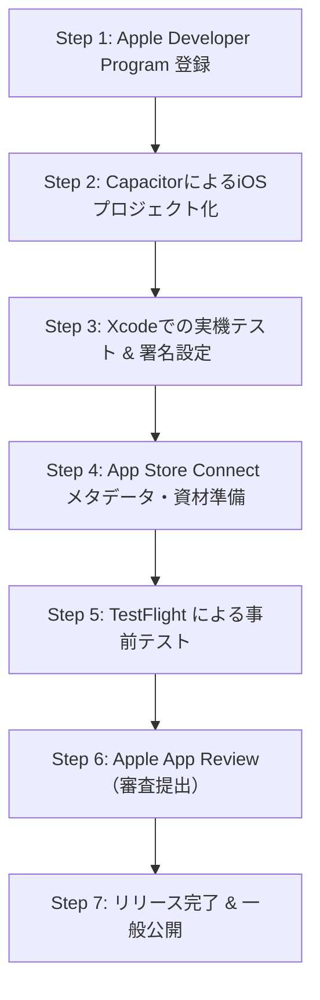

# 瞬間パターントレーニング iOS（App Store）公開ガイド & チェックリスト

本ドキュメントでは、現在開発中のWeb/PWAアプリ「瞬間パターントレーニング（瞬トレ）」を **iOS App Store で公開するための具体的な手続き、必要資材、Apple審査対策** を体系的にまとめています。

---

## 1. 公開方式の選定（2つの選択肢）

本アプリは HTML / CSS / JavaScript で構築された PWA（Progressive Web App）です。iOSユーザーに届ける方法は以下の2通りあります。

| 項目 | ① App Store 公開（ネイティブアプリ化） | ② PWA 配布（Safari ホーム画面追加） |
| :--- | :--- | :--- |
| **ユーザーの取得経路** | App Store で検索・ダウンロード | URLにアクセスし「ホーム画面に追加」 |
| **初期・維持費用** | **年間 $99（約15,000円）**（Apple Developer Program） | **完全無料**（GitHub Pages等でホスト可能） |
| **Apple審査** | **あり**（約1〜2日、リジェクト対応リスクあり） | **なし**（即時公開・アップデート即反映） |
| **通知・バックグラウンド**| ネイティブバックグラウンド音声・通知対応 | Web API経由（制限あり） |
| **信頼性・リーチ** | App Store掲載による高い信頼性と検索流入 | 既存ファン・直接URL共有が主 |

> 💡 **推奨戦略**:  
> まずは **② PWA** としてWeb上にデプロイして知人や初期テスターにすぐに触ってもらいつつ、**① App Store** 審査の準備（Capacitor導入、資材作成、デベロッパー登録）を並行して進めるのが最もスムーズです。

---

## 2. App Store 公開の全体フロー（7ステップ）



### Step 1: Apple Developer Program への登録
1. [Apple Developer Program](https://developer.apple.com/programs/) にアクセス。
2. 個人の Apple ID（または法人組織）で登録。
   - **費用**: 99米ドル / 年（自動更新）
   - **法人の場合**: D-U-N-S Number の取得が必要。
   - **個人の場合**: 本人確認（二段階認証、パスポート/マイナンバーカード等）が必要です。

### Step 2: Capacitor による iOS ラッパー化（ネイティブ化）
現在Web資産（HTML/CSS/JS/音声ファイル）が完成しているため、**Capacitor** を利用することで数コマンドでXcodeプロジェクト（Swift/WKWebView）へ変換できます。

```bash
# プロジェクト直下で実行
cd /Users/gaku/.gemini/antigravity/scratch/shunkan-eisakubun

# 1. npm 初期化（未設定の場合）
npm init -y

# 2. Capacitor のインストール
npm install @capacitor/core @capacitor/cli @capacitor/ios

# 3. Capacitor の初期化
npx cap init "瞬間パターントレーニング" "com.yourname.shunkantraining" --web-dir "."

# 4. iOSプラットフォームの追加
npx cap add ios

# 5. Web資産の同期
npx cap copy ios
```

### Step 3: Xcode でのビルド・署名・実機確認
```bash
# Xcode を起動
npx cap open ios
```
- **Signing & Capabilities**: 登録した Apple ID で Team を選択し、自動署名（Automatically manage signing）を有効化。
- **Info.plist 設定**:
  - `NSMicrophoneUsageDescription`: （音声入力・発音判定を使う場合）
  - `UIBackgroundModes`: バックグラウンド再生（audio）を有効化。
- 実機 iPhone を Mac に繋ぎ、Run（ビルド & 転送）してスワイプやオフライン音声が滑らかに動くか確認。

### Step 4: 審査用アセット・書類の準備（必須一覧）

| 項目 | 規格・要件 | 備考 |
| :--- | :--- | :--- |
| **アプリアイコン** | 1024 x 1024 px PNG（透過なし・角丸なし） | 現在の `icon-512.png` から高解像度版を書き出し |
| **スクリーンショット** | **6.9 / 6.7インチ**（1290 x 2796 または 1320 x 2868）<br>**6.5インチ**（1284 x 2778）<br>**5.5インチ**（1242 x 2208 ※任意） | 最低3枚〜最大10枚。主要画面（ホーム、スワイプ、リスト、聞き流し） |
| **プライバシーポリシーURL** | インターネット上で閲覧可能な Web ページURL | GitHub Pages や Notion 等でホスト必須 |
| **サポートURL** | 問い合わせ窓口（フォーム、GitHub Issues、Xアカウント等） | ユーザーサポート用URLが必須 |
| **App Review用連絡先** | 開発者の氏名、メールアドレス、電話番号 | 審査員からの連絡用 |

### Step 5: TestFlight による事前テスト
1. Xcode の「Product」➔「Archive」からバイナリ（IPA）を App Store Connect へアップロード。
2. TestFlight タブで内部テスター（自分・関係者）に配布し、実際のダウンロード＆起動をテスト。

### Step 6: App Review（審査提出）
- App Store Connect でアプリ情報（説明文、キーワード、年齢制限レーティング等）を入力し、「審査へ提出」をクリック。
- 通常 **24時間〜48時間** で審査結果（承認、またはリジェクト理由）が届きます。

---

## 3. App Store 掲載用テキスト（メタデータ雛形）

そのままコピペして利用できるストア掲載用テンプレートです。

### 基本情報
- **アプリ名**: 瞬間パターントレーニング - 実戦英会話70構文 (30文字以内)
- **サブタイトル**: 瞬発力で鍛える反射的英語アウトプット (30文字以内)
- **プライマリカテゴリ**: 教育 (Education)
- **セカンダリカテゴリ**: 辞書/辞典 (Reference) または ライフスタイル
- **年齢制限レーティング**: 4+ (全年齢対象)
- **キーワード (100文字カンマ区切り)**:
  `英語,英会話,瞬間英作文,パターンプラクティス,リスニング,聞き流し,TED,スピーキング,発音,英語学習,日常英会話,ビジネス英語`

### アプリ説明文（4,000文字以内）
```markdown
【頭でわかっている英語を、口から反射的に出る英語へ！】

「瞬間パターントレーニング（瞬トレ）」は、ネイティブが日常やビジネスで無意識に使いこなす【実戦英会話70構文】と【知的思考GRIT編】を、瞬発的に口から出すための英語アウトプット訓練アプリです。

文法は理解しているのに、いざという時に言葉が詰まってしまう……そんな悩みを、徹底的な反復パターントレーニングで打破します。

━━━━━━━━━━━━━━━━━━━
■ 瞬トレが選ばれる5つの特長
━━━━━━━━━━━━━━━━━━━

1. 【厳選された70の黄金構文 ＋ GRIT編】
クッション言葉、マイルドな反論、自己開示、スマートな依頼など、教科書英語ではない「本物の英会話パターン」をテーマ別に体系化。さらにTED Talksで名高いアンジェラ・ダックワース氏の『GRIT（やり抜く力）』に基づく知的表現も収録。

2. 【直感的なワンタップ自己採点で瞬間判定】
日本語のシチュエーションを見て、瞬時に英語を口に出す。
・◯ 言えた（習得リストへ）
・△ あやしい（復習サイクル調整）
・✕ 言えなかった（復習キューへ優先追加）
テンポ良く何問も反復できるから、スキマ時間の学習が劇的に加速します。

3. 【通勤・運動中にも最適な「聞き流しモード」】
画面を見ずに学べるハンズフリー自動音声再生。
「日本語 ➔ ポーズ ➔ 英語 ➔ リピート」のリズムで、移動中やランニング中も耳と口を英語漬けにできます。

4. 【完全オフライン対応】
通信量を気にせず、地下鉄や飛行機の中でもすべての例文・音声がストレスフリーで再生されます。

5. 【挫折させない習慣化システム】
毎日の連続日数を守る「ストリーク保護シールド」や、成長を実感できるアチーブメントバッジ機能を搭載。忙しい社会人でも無理なく学習を継続できます。

━━━━━━━━━━━━━━━━━━━
■ こんな方におすすめ
━━━━━━━━━━━━━━━━━━━
・英会話の第一声がなかなか出てこない方
・知っている単語や文法を会話で使いこなせない方
・通勤やスキマ時間で効率よくスピーキング力を鍛えたい方
・ビジネス英語で角を立てないスマートな表現を身につけたい方

完全無料・ユーザー登録不要で、今すぐ始められます。
あなたの英語を「知識」から「反射」へと進化させましょう！
```

---

## 4. Apple審査（App Review）で注意すべきポイント & 対策

App Store審査でWebラッパー型アプリがリジェクト（却下）されやすいポイントと、その回避策です：

### ① ガイドライン 4.2「最低限の機能（Minimum Functionality）」
- **審査員の視点**: 「ただWebサイトを画面に表示しただけのアプリなら、Safariで見れば十分」としてリジェクトされることがあります。
- **本アプリの強み & 対策**:
  - 本アプリは既に **ローカルオフライン音声再生**、**滑らかなタッチ・スワイプアニメーション**、**ローカルデータ永続化（LocalStorage/IndexedDB）** を備えています。
  - アプリの審査備考（Review Notes）に「本アプリはネイティブのジェスチャー操作（Swipe）に特化し、完全オフラインで学習できる独立した教育ツールである」旨を英語で明記すればクリア可能です。

### ② プライバシーポリシーの必須化（Guideline 5.1.1）
- アプリ内で個人情報を取得しなくても、**「個人情報を収集・送信しない」旨を記載したプライバシーポリシーWebページ** のURLが必須です。
- 本アプリの利用規約モーダルの文面をWeb上に公開してURLを設定すれば完了します。

### ③ サードパーティ商標に関する配慮（Guideline 5.2.1）
- アプリタイトルや説明文で「瞬間英作文（ベレ出版の商標）」や「TED」を公式と誤認させる表記は避け、「瞬間パターントレーニング」「実戦英会話構文マスター」を正式名称とし、権利表記・免責事項を明記しておくことが安全です（本アプリの `index.html` および `USER_MANUAL.md` に記載済み）。
